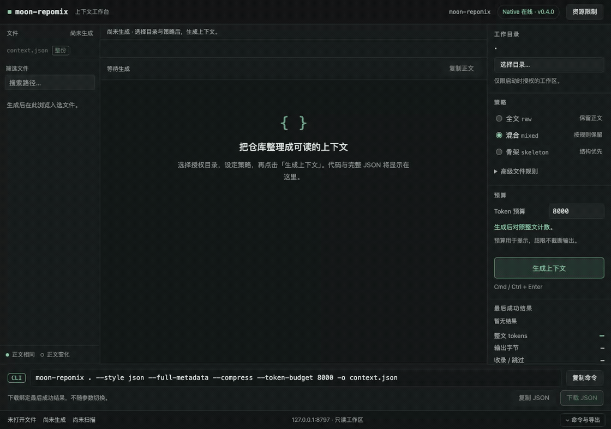

# moon-repomix

`moon-repomix` 是由 MoonBit native 实现的代码仓库上下文工具，运行时无需 Node.js。它支持读取本地目录或公开 HTTPS Git 仓库，输出 XML、Markdown、JSON 或 plain 文本；默认对完整原文先执行敏感信息启发式扫描，再做目录投影、AST 骨架压缩或按需读取，并对最终交付的完整正文执行精确 `o200k_base` token 计量。

除普通目录打包外，项目围绕**任务预算规划**（`plan_task_context`）与**代码按需补读**（`read_code_context`）提供跨 SDK、CLI、MCP 和浏览器工作台（WebUI）的统一上下文工作流：

- **AST 骨架压缩（7 类语言）**：MoonBit（含 `.mbti`）、JavaScript / TypeScript（含 JSX / TSX）、Python、Go、Rust、Java。
- **符号读取、符号目录与同文件依赖索引**：支持 JavaScript / JSX / TypeScript / TSX、Python、MoonBit（`.mbt` / `.mbti`）。

## 版本边界与当前源码说明

[GitHub Release v0.7.0](https://github.com/Delthin/moon-repomix/releases/tag/v0.7.0) 与 [Mooncakes 注册表 `Delthin/moon_repomix@0.7.0`](https://mooncakes.io/docs/Delthin/moon_repomix) 提供统一 `ContextRequest` 协议与校验 API、CLI `--context-request` / `--context-stdio`、MoonBit（`.mbt` / `.mbti`）符号与同文件依赖索引，以及 WebUI 请求配置保存/导入。普通打包、SDK `pack` / `read_code_context` / `plan_task_context` 和既有 MCP、工作台用法保持兼容。

## 统一任务规划与代码补读协议

v0.7.0 中，任务预算（必选/可选文件模式与优先级）和代码补读（完整符号、不连续行范围、全文或符号目录）共享版本化 `ContextRequest` JSON（规范化上限 64 KiB）。以下请求可直接在本仓库使用，读取 `src/version.mbt` 的 `version` 符号及同文件依赖：

```json
{
  "schemaVersion": 1,
  "operation": "read_code_context",
  "spec": {
    "maxTokens": 8000,
    "requests": [
      { "path": "src/version.mbt", "symbols": ["version"], "includeDependencies": true }
    ]
  }
}
```

| 入口 | 如何使用同一份 `ContextRequest` | 权限、限额与会话边界 |
| :--- | :--- | :--- |
| **CLI** | `moon-repomix . --context-request request.json`（或 `-o response.json`）；多轮 JSONL 用 `moon-repomix . --context-stdio` | 规格内路径相对命令指定的授权根解释；响应 JSON 封装完整正文、计量与审计 |
| **SDK** | `ContextRequest::from_json` 校验后取出 `spec_json()`，转交 `CodeContextSpec` / `TaskContextSpec` 并调用对应 Root API | 不自动执行或授予文件权限；用 `CodeContextSession` 管理最多 3 轮成功累计预算 |
| **MCP** | 直接作为 `execute_context_request` 的 `arguments`；用 `context_capabilities` 查询主机能力与后缀 | 绑定启动时固定的只读根目录；原 `plan_task_context` / `read_code_context` 继续兼容 |
| **WebUI / HTTP** | 工作台切到任务预算或代码补读后“导入配置”/“保存配置”；HTTP 用 `{directory, request}` 外层对象发送至 `POST /api/context-request` | 沿用页面当前授权目录；保存的配置不含源码、目录与会话 ID |

代码补读会话由首轮 `spec.maxTokens` 固定累计正文硬上限，续读在顶层传 `continueFrom`（不带 `maxTokens`），最多成功 3 轮，失败不扣额度。会话 ID 不能跨进程或跨入口迁移。代码审计嵌于正文并计入正文预算，任务审计独立计数；正文 cap 均不含外层传输封装。普通打包参数与主机输出风格仍按各入口规则收紧。

## 安装与第一次运行

### 1. 使用 v0.7.0 预编译归档

从 [GitHub Releases (`v0.7.0`)](https://github.com/Delthin/moon-repomix/releases/tag/v0.7.0) 下载对应平台归档并通过 `SHA256SUMS` 校验。解压时请保留 `bin/`、`share/`、`LICENSES/` 的相对目录位置（分词词表等资源随包附带）。

```sh
# Unix
./bin/moon-repomix /path/to/project

# Windows PowerShell
.\bin\moon-repomix.exe "C:\path\to\project"
```

默认在当前启动目录生成 `repomix-output.xml`。本地目录打包无需安装 Git；仅在读取 Git diff/log 或克隆公开 HTTPS 仓库时需要系统 `git`。

### 2. 从当前源码构建与安装

源码构建要求 MoonBit **0.10.20 及以上**与平台 C 工具链（默认 `native` 后端），源码运行会自动发现仓库内 `assets`：

```sh
moon update
moon run src/cmd/moon-repomix --release -- examples/demo -f md -o -

# 安装到用户目录（Windows 可用 "$env:LOCALAPPDATA\moon-repomix"）
moon run --target native scripts/install.mbtx "$HOME/.local"
```

将安装前缀下的 `bin` 加入 `PATH` 后即可直接调用 `moon-repomix`。

## 常用 CLI 命令

```sh
# 输出 Markdown 到文件；-o - 表示正文写 stdout、统计信息写 stderr
moon-repomix ./project -f md -o context.md

# 提取 AST 骨架压缩；按 glob 过滤并输出 JSON
moon-repomix ./project --compress --include 'src/**,README.md' -f json -o context.json

# 软预算检查（超限仍写出完整文件并以状态码 1 退出，不同于任务/代码硬预算）
moon-repomix ./project --budget 12000

# 分卷输出（目标目录必须尚不存在；每卷按完整输出计量，索引文件单独计数）
moon-repomix ./project --compress --split 12000 -f md -o review-parts
```

更多选项可通过 `--help` 或 `--help-all` 查看。

## 浏览器工作台（WebUI）与 MCP 服务

```sh
# 启动本地浏览器工作台（默认监听 http://127.0.0.1:8765）
moon-repomix ./project --webui

# 启动固定只读根目录的 stdio MCP 服务
moon-repomix /absolute/project --mcp --mcp-max-tokens 12000
```

工作台提供**普通打包**、**任务预算**与**代码补读**三种工作方式。下图演示普通打包流程：



MCP 客户端配置细节参见 [docs/mcp.md](docs/mcp.md)。

## MoonBit SDK

在 `moon.mod` 添加 `Delthin/moon_repomix`，并在包配置中导入 `"Delthin/moon_repomix" @repomix`。`Runtime` 会加载 `o200k_base.tiktoken` 与同目录的 `tokenizer-unicode-16.0.0.txt` 并校验 SHA-256，可在多次调用间复用；返回结果不会自动写盘：

```moonbit
async fn run_pack() -> Unit {
  let runtime = @repomix.Runtime::load("/absolute/share/moon-repomix/o200k_base.tiktoken")
  let options = @repomix.options("/absolute/project", style=@repomix.Style::Json, compress=true)
  let result = @repomix.pack(options, runtime)
  println(result.tokens.to_string())
}
```

## 安全扫描与精确计量说明

- **编码与启发式安全扫描**：仅处理有效 UTF-8 普通文件（去 BOM、保留原换行）。先扫描完整原文，命中的敏感文件、patch 或 commit 整项排除；若自定义模板自身命中敏感规则则直接停止。启发式扫描不能替代人工审阅，分享前请检查输出。
- **资源边界与完整计数**：token 预算只约束输出正文，不是进程内存配额（普通打包默认单文件 50 MiB、候选 20,000 个、原始总读取 200 MiB，服务端点有更严格上限）。总 token 针对含格式头部、模板与包装在内的完整正文计算，而非逐文件数字简单相加。

## 文档导航、致谢与许可

- **上下文与入口文档**：[统一请求协议](docs/context-requests.md) · [CLI 上下文读取](docs/context-cli.md) · [代码补读规格](docs/code-context.md) · [任务预算规格](docs/task-context.md) · [WebUI 指南](docs/webui.md) · [MCP 指南](docs/mcp.md)
- **参考与维护文档**：[CLI 参数参考](docs/cli.md) · [配置文件](docs/configuration.md) · [分卷说明](docs/partition.md) · [性能基准（v0.4.1 基线）](docs/performance.md) · [工具链说明](docs/toolchain.md) · [迁移指南](docs/migration.md) · [公开接口 (`pkg.generated.mbti`)](src/pkg.generated.mbti) · [三平台 CI 工作流](https://github.com/Delthin/moon-repomix/actions/workflows/ci.yml)
- **社区与治理**：[CONTRIBUTING.md](CONTRIBUTING.md) · [SECURITY.md](SECURITY.md) · [CHANGELOG.md](CHANGELOG.md)
- **来源与许可**：本项目基于 [MIT License](LICENSE) 开源。产品设计致敬上游 [yamadashy/repomix](https://github.com/yamadashy/repomix)；第三方组件与语法压缩相关许可详见 [LICENSES/](LICENSES) 与 [src/compression/THIRD_PARTY.md](src/compression/THIRD_PARTY.md)。
