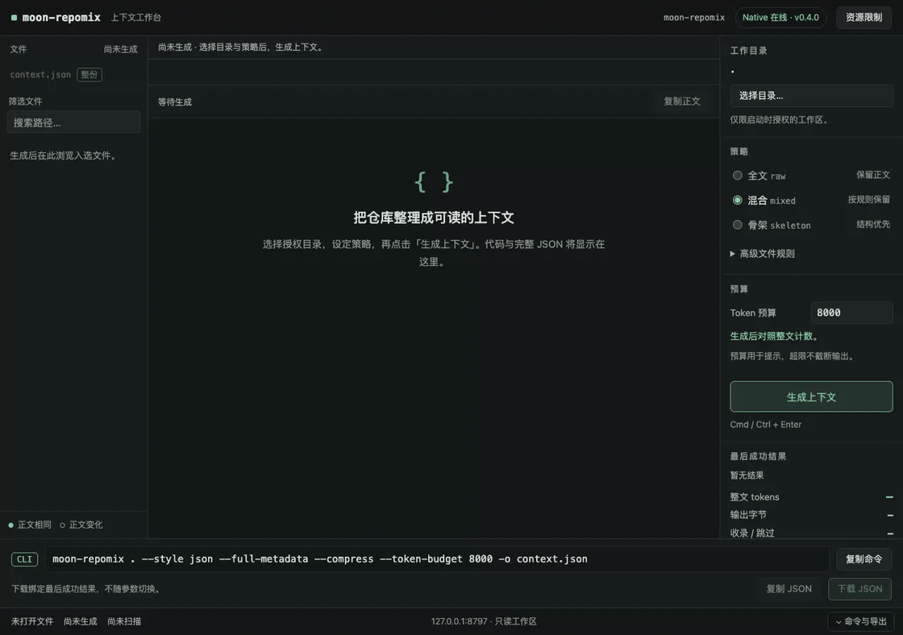

# moon-repomix

把本地目录或公开 HTTPS 仓库整理成 XML、Markdown、JSON 或纯文本，供 AI 阅读、代码评审和问题追踪。使用 MoonBit native 实现，提供 CLI、SDK 和本地浏览器工作台；解析器和分词资源随源码或安装包提供，运行时不需要 Node.js。

当前版本 **v0.4.1**，提供 [三平台安装包](https://github.com/Delthin/moon-repomix/releases/tag/v0.4.1) 和 [Mooncakes SDK](https://mooncakes.io/docs/Delthin/moon_repomix@0.4.1)。本版优化精确计数、扫描和原生 AST 流水线；工作台、混合全文/骨架、精确分卷及只读 MCP 的用法保持一致。完整变化见 [Changelog](CHANGELOG.md)，升级步骤见 [迁移指南](docs/migration.md)。

## 安装与第一次运行

从 [v0.4.1 Release](https://github.com/Delthin/moon-repomix/releases/tag/v0.4.1) 下载平台归档，用附带的 `SHA256SUMS` 校验。解压后保留 `bin`、`share` 和 `LICENSES` 的相对位置，在解压目录运行：

```sh
./bin/moon-repomix /path/to/project
```

Windows PowerShell：

```powershell
.\bin\moon-repomix.exe "C:\path\to\project"
```

结果写到启动目录的 `repomix-output.xml`，终端显示文件数和精确 token 数。也可将 `bin` 加入 `PATH`，在要处理的项目目录直接运行 `moon-repomix`。归档运行不需要 MoonBit；本地打包和骨架压缩不需要 Git，差异、历史和远程获取需要系统 Git。

### 从源码运行

从源码构建需要固定的 MoonBit **0.10.15+943464bfa** 和平台 C 工具链，见 [工具链](docs/toolchain.md)。在仓库根目录运行：

```sh
moon update
moon run src/cmd/moon-repomix --release -- examples/demo -f md -o -
```

终端显示示例源码和目录结构；正文写 stdout，统计与诊断写 stderr。项目默认使用 native，标准源码构建自动查找 `assets/` 资源。要将当前源码与资源一起安装到本地前缀：

```sh
moon run --target native scripts/install.mbtx "$HOME/.local"
```

Windows PowerShell 使用 `moon run --target native scripts/install.mbtx "$env:LOCALAPPDATA\moon-repomix"`。安装只需执行一次，将前缀的 `bin` 加入 `PATH` 后，日常使用下面的 `moon-repomix` 命令。移动安装目录时一并保留 `bin`、`share` 和 `LICENSES`。

## 常用命令

```sh
# 当前目录，默认输出 repomix-output.xml
moon-repomix

# 导出 Markdown；加 --compress 提取骨架
moon-repomix ./project -f md -o context.md
moon-repomix ./project --compress -f md -o structure.md

# 只选源码和 README，导出 JSON
moon-repomix ./project --include 'src/**,README.md' -f json -o context.json

# 检查单文档预算，或按每卷硬上限分卷
moon-repomix ./project --budget 12000
moon-repomix ./project --compress --split 12000 -f md -o review-parts
```

输入目录默认是当前目录。格式用 `-f` 指定：`xml`、`md`、`json`、`txt`；未指定时使用配置值或 XML。`-o -` 将正文写 stdout。`--budget` 超限仍保留完整输出并退出 **1**；`--split` 限制每卷的最终 token 数，`-o` 此时是必须不存在的新目录，索引另外计数。

用 `moon-repomix --help` 查看常用任务，`--help-all` 查看全部参数。已有 `--style`、`--token-budget`、`--split-output` 继续可用；JSON 字段名称保持不变。Git 差异、远程仓库、stdin、保存常用配置等用法见 [CLI 按任务速查](docs/cli.md)，关键文件保留全文和自动化组合见 [使用场景](docs/scenarios.md)。

输出和显式配置路径相对启动目录，自动配置位于输入根。普通输出文件会原子替换已有同名文件；失败时保留旧输出。分卷目标必须不存在。详见 [配置](docs/configuration.md) 与 [文件选择](docs/file-selection.md)。

## 浏览器工作台

工作台使用原生 HTML/CSS/JavaScript，通过本地 HTTP 接口调用 MoonBit native 引擎。目录浏览、源码读取、安全扫描、AST 压缩和最终 JSON 的精确 token 计数均由 Native 服务完成；浏览器负责配置、查看与下载。



安装 v0.4.1 后，在要处理的项目目录运行：

```sh
moon-repomix --webui
```

也可在本仓库根目录直接运行 `moon run src/cmd/moon-repomix --release -- --webui`。两种方式均默认处理当前目录，自动定位词表和页面资源；指定其他项目时使用 `moon-repomix ./project --webui`。

打开 `http://127.0.0.1:8765`，在右侧选择授权目录、全文/骨架/混合策略及文件规则，点击“生成上下文”；左侧浏览结果文件，中间切换原文、处理后正文或完整 JSON，底部复制 CLI 或下载原始 JSON。

修改参数会将现有结果标为旧结果，下一次生成成功后才替换；预算超限仍保留完整输出。动图来自真实 Native 服务操作，三种模式的浏览器下载已与相同参数 CLI 输出逐字节核对。端口设置、输入限额与服务边界见 [工作台指南](docs/webui.md)。

## 输出、计数与安全

- 默认保留完整正文；`--compress` 提取语法骨架，保留声明、类型、注释与结构。支持 MoonBit（含 `.mbti`）、JavaScript/TypeScript（含 JSX/TSX）、Python、Go、Rust、Java；其他语言或无精确 token 收益时保留原文。范围见 [仓库上下文](docs/context.md)。
- 读取有效 UTF-8 普通文件，去除 UTF-8 BOM 并保留换行。默认单文件上限 50 MiB；另有 20,000 个过滤后普通候选、200 MiB 原始读取的总量限制。链接、二进制、无效 UTF-8 等跳过原因见 [错误指南](docs/errors.md)。
- 默认扫描压缩前原文，命中时排除整个文件、Git 补丁或提交；模板命中则停止整个打包。扫描是启发式检测，分享前仍应审阅结果，详见 [安全边界](SECURITY.md) 和 [检测规则](docs/security.md)。
- 对完整渲染字符串精确计算 `o200k_base` tokens，包含格式包装、模板与显示装饰。文件排名和目录统计不能代替最终预算；分卷的独立索引开销见 [分卷](docs/partition.md)。

打包与计数在内存中完成，token 预算不是内存配额。当前源码在固定 35 MB TypeScript 大库的五轮 CLI 对照中，macOS 原文/完整元数据压缩的耗时中位数为 1.05 / 1.43 秒，原版为 1.37 / 1.62 秒；Linux 分别为 1.82 / 2.40 秒，原版为 2.62 / 3.59 秒。平台、内存代价、Linux 原文回退、全部样本及常驻 MCP 结果见 [性能测量](docs/performance.md)。

## SDK

SDK 模块为 [`Delthin/moon_repomix@0.4.1`](https://mooncakes.io/docs/Delthin/moon_repomix@0.4.1)。在调用项目的 `moon.mod` 中声明依赖，在 `moon.pkg` 导入：

```moonbit
import {
  "Delthin/moon_repomix" @repomix,
}
```

在 `async fn` 中加载资源并打包：

```moonbit
let runtime = @repomix.Runtime::load("/absolute/share/moon-repomix/o200k_base.tiktoken")
let options = @repomix.options("/absolute/project", style=@repomix.Style::Json, compress=true)
let result = @repomix.pack(options, runtime)
// result.text 是完整文档，result.tokens 是最终 token 数。
// result.document 提供规范模型；files / skipped / findings / security / budget 提供处理结果。
```

词表同目录须有 `tokenizer-unicode-16.0.0.txt`，加载时校验两份资源的 SHA-256。`Runtime` 可复用于多次顺序打包；SDK 返回结果，不写输出文件。`pack_volumes`、`explain_selection`、选项与结构字段见 [迁移](docs/migration.md) 和 [生成接口](src/pkg.generated.mbti)。

## 文档与贡献

[CLI 速查](docs/cli.md) · [工作台](docs/webui.md) · [场景](docs/scenarios.md) · [配置](docs/configuration.md) · [输出格式](docs/output.md) · [分卷](docs/partition.md) · [机器报告](docs/reports.md) · [MCP](docs/mcp.md) · [入选原因](docs/selection-explanation.md) · [分词](docs/tokenization.md) · [错误处理](docs/errors.md)

[贡献指南](CONTRIBUTING.md) 说明定点测试、格式与接口更新、资源许可；[工具链](docs/toolchain.md) 说明本地构建和归档。[演示指南](docs/demo.md) 提供可保留产物的三步演示。[三平台 CI](https://github.com/Delthin/moon-repomix/actions/workflows/ci.yml) 覆盖 macOS arm64、Linux x64 和 Windows x64。

## 来源与许可

项目参考 [Repomix](https://github.com/yamadashy/repomix) 的仓库上下文生成行为，采用 [MIT](LICENSE) 许可。第三方代码及资源告知保存在 [LICENSES/](LICENSES/)，解析器固定版本和本地修改见 [来源清单](src/compression/THIRD_PARTY.md)。
